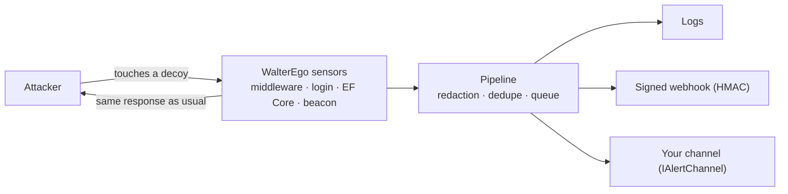
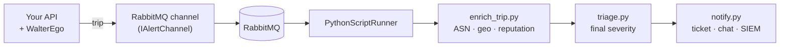

# WalterEgo

[](https://github.com/ScriptRunnerKit/WalterEgo/actions/workflows/ci.yml)
[](https://github.com/ScriptRunnerKit/WalterEgo/actions/workflows/codeql.yml)
[](https://scorecard.dev/viewer/?uri=github.com/ScriptRunnerKit/WalterEgo)
[](LICENSE)

**English** | [Português](README.pt-br.md)

**Native honeytokens and deception for .NET.**

Create fake *alter egos* of your assets — endpoints, users, API keys, database records, configuration, session tokens and files — and know the exact moment someone touches them.

> 🚧 **Under development.** The public API may still change until version `0.1.0`. The examples below show the intended shape.

---

## Why honeytokens?

Most security tools try to stop the attacker. When prevention fails, detection tends to be noisy and late.

A honeytoken is a fake asset that **no legitimate user has any reason to touch**. If someone touched it, the signal is high-confidence: a leaked credential, an exfiltrated database, a scanner doing reconnaissance or someone a little too curious on the inside.

WalterEgo brings this into your .NET application with a few lines of code, using what you already know: DI, `IOptions`, `ILogger`, ASP.NET Core middleware and EF Core interceptors.

The name comes from **alter ego**: each decoy is an "other self" of a real asset, which exists only to reveal whoever goes looking for it.

## The 7 alter egos

| Alter ego | What it is | What a trip indicates |
|---|---|---|
| **Honey endpoint** | Routes no legitimate client calls (`/.env`, `/.git/config`, `/admin/backup.zip`) | Automated or manual reconnaissance |
| **Honey user** | Users that belong to no one (`admin_backup`) | Leaked credentials being tested |
| **Honey API key** | Keys in the same format as the real ones, which never authorize anything | A leaked secret in use |
| **Honey row** | Fictitious records in sensitive tables | Targeted access to, or changes in, data nobody should know about |
| **Honey config** | Fake, attractive configuration entries | Someone read your configuration and tried to use it |
| **Honey JWT / cookie** | Decoy session tokens that never validate | Session theft or replay |
| **Honey file** | Attractive files (`.env.production`, `customers-backup.sql`) with decoy credentials or a beacon | Exfiltration or unauthorized access to files |

## How it works



- **Indistinguishable:** the attacker gets the same response as for any ordinary request (the same 404, the same "invalid login"), with no headers or strings that give WalterEgo away.
- **Out of the request path:** alerts are sent in the background, adding no latency.
- **Fail-safe:** if an alert channel goes down, your application keeps working normally.
- **Decoys never grant real access:** honey users do not authenticate, honey keys do not authorize, honey JWTs do not validate.
- **Privacy by default:** minimal collection (IP, user agent, method and path; never the body, cookies or authentication headers) and secret redaction on by default. The IP can be truncated, pseudonymized or left out through configuration.
- **Standard events:** trips are emitted in the OCSF format (Detection Finding), ready for SIEMs.

## Quick start

```bash
dotnet add package WalterEgo.AspNetCore --prerelease
dotnet add package WalterEgo.Alerting.Webhook --prerelease
```

```csharp
var builder = WebApplication.CreateBuilder(args);

builder.Services.AddWalterEgo(o => o.ServiceName = "orders-api")
    .AddHoneyEndpoints(e =>
    {
        e.Add("/.env", Severity.Medium);
        e.Add("/admin/backup.zip", Severity.High);
    })
    .AddHoneyUsers(u => u.Add("admin_backup", Severity.Critical))
    .AddHoneyApiKeys(k => k.FromConfiguration("WalterEgo:ApiKeys"))
    .AddWebhookAlerts(w =>
    {
        w.Url = new Uri(builder.Configuration["WalterEgo:Webhook:Url"]!);
        w.SigningSecret = builder.Configuration["WalterEgo:Webhook:Secret"]!;
    });

var app = builder.Build();

app.UseForwardedHeaders();
app.UseWalterEgo();       // before authentication
app.UseAuthentication();
app.UseAuthorization();

app.Run();
```

### Generating decoys with the CLI

```bash
dotnet tool install -g WalterEgo.Cli --prerelease

walterego generate apikey --prefix ord_live_ --name "legacy-ci-key" --placement "LEGACY_KEY variable in CI"
walterego generate file env --name ".env.production" --out ./decoys/ --placement "backups bucket"
walterego test-alert --channel webhook
```

The CLI returns the decoy value (for you to plant) and the configuration snippet with **only an HMAC** (to register in the application). The plain-text value never needs to live in your app, and whoever reads your configuration cannot tell which values are decoys.

Each decoy records **where it was planted** (`--placement`). When it trips, you know exactly which place leaked. Generate a new decoy for each place.

## Packages

| Package | What for |
|---|---|
| `WalterEgo.Core` | Model, decoy registry, trip pipeline and logging channel |
| `WalterEgo.AspNetCore` | Honey endpoints, API keys, JWT/cookies, beacons and the honey user guard |
| `WalterEgo.AspNetCore.Identity` | Honey users integrated with ASP.NET Core Identity |
| `WalterEgo.EntityFrameworkCore` | Honey rows with EF Core interceptors |
| `WalterEgo.Alerting.Webhook` | Webhook alerts signed with HMAC |
| `WalterEgo.Generators` | Generation of plausible decoys |
| `WalterEgo.Cli` | The `walterego` tool to generate, validate and test |

## WalterEgo + PythonScriptRunner

WalterEgo and [PythonScriptRunner](https://github.com/ScriptRunnerKit/PythonScriptRunner) are **sibling projects of the ScriptRunnerKit organization**, designed to work well together but **completely independent**:

- Separate NuGet packages (`WalterEgo.*` on one side, PythonScriptRunner on the other).
- Neither depends on the other. You can use WalterEgo without ever installing PythonScriptRunner, and vice versa.

**The split is simple: WalterEgo detects; PythonScriptRunner reacts.**

PythonScriptRunner runs Python scripts from .NET with typed contracts, pipelines, RabbitMQ queues and schedules. That makes it a natural destination for WalterEgo trips: everything the Python ecosystem does well in security (IP enrichment, reputation lookups, correlation, response automation) can run from a WalterEgo alert.



How the two connect:

1. WalterEgo exposes the `IAlertChannel` interface, which accepts any alert destination.
2. A channel of a few lines publishes each trip (an [OCSF](https://schema.ocsf.io/classes/detection_finding) Detection Finding event) to a RabbitMQ queue.
3. PythonScriptRunner consumes that queue and runs a pipeline of Python scripts with the event as typed input.

Some uses:

- Enrich the source IP with ASN, geolocation and reputation.
- Open a ticket automatically for high-severity trips.
- Correlate trips from several services in the same time window.
- Generate a new alter ego to replace the one that was discovered, and notify the team.

A complete sample, with `docker compose`, shows the end-to-end integration in `samples/WalterEgo.Samples.PythonScriptRunner`. The integration exists as an **example and documentation**, not as a package, precisely to keep the two projects independent.

> ⚠️ If your pipeline sends IPs to third-party services (for example, reputation services), assess the privacy implications (LGPD/GDPR).

## Responsible use

WalterEgo is an **exclusively defensive** tool, meant to detect unauthorized access to **your own** systems.

- There is no "hack-back" feature and nothing that attacks the source.
- Source data (IP, user agent) may be personal data; WalterEgo collects the minimum and applies redaction by default. Check the legal basis with your legal team.
- Always use fictitious data in decoys.
- Honeytokens complement, rather than replace, your other security controls.

## Security

Found a vulnerability? **Do not open a public issue.** Follow the instructions in [SECURITY.md](SECURITY.md) to report it privately.

## Contributing

Contributions are welcome! Before opening a pull request with a new feature, **open an issue** describing the idea so we can agree on the scope. See [CONTRIBUTING.md](CONTRIBUTING.md).

## License

[MIT](LICENSE)
