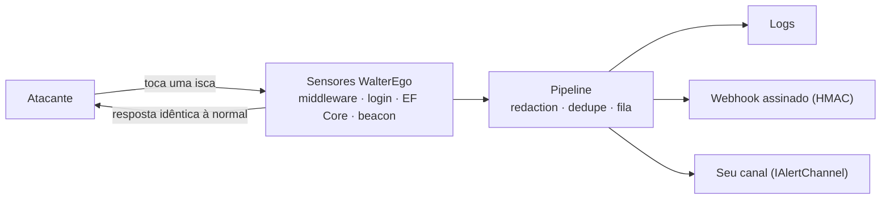
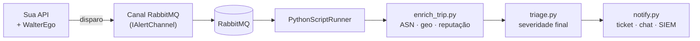

# WalterEgo

[](https://github.com/ScriptRunnerKit/WalterEgo/actions/workflows/ci.yml)
[](https://github.com/ScriptRunnerKit/WalterEgo/actions/workflows/codeql.yml)
[](https://scorecard.dev/viewer/?uri=github.com/ScriptRunnerKit/WalterEgo)
[](LICENSE)

[English](README.md) | **Português**

**Honeytokens e deception nativos para .NET.**

Crie *alter egos* falsos dos seus ativos — endpoints, usuários, chaves de API, registros no banco, configurações, tokens de sessão e arquivos — e saiba no exato momento em que alguém encostar neles.

> 🚧 **Em desenvolvimento.** A API pública ainda pode mudar até a versão `0.1.0`. Os exemplos abaixo mostram o formato pretendido.

---

## Por que honeytokens?

A maioria das ferramentas tenta impedir o atacante. Quando a prevenção falha, a detecção costuma ser ruidosa e tardia.

Um honeytoken é um ativo falso que **nenhum usuário legítimo tem motivo para tocar**. Se alguém tocou, o sinal é de alta confiança: credencial vazada, banco exfiltrado, scanner fazendo reconhecimento ou alguém curioso demais lá dentro.

O WalterEgo traz isso para dentro da sua aplicação .NET com poucas linhas de código, usando o que você já conhece: DI, `IOptions`, `ILogger`, middleware do ASP.NET Core e interceptors do EF Core.

O nome vem de **alter ego**: cada isca é um "outro eu" de um ativo real, que existe só para revelar quem o procura.

## Os 7 alter egos

| Alter ego | O que é | O que um disparo indica |
|---|---|---|
| **Honey endpoint** | Rotas que ninguém legítimo chama (`/.env`, `/.git/config`, `/admin/backup.zip`) | Reconhecimento automatizado ou manual |
| **Honey user** | Usuários que não pertencem a ninguém (`admin_backup`) | Credenciais vazadas sendo testadas |
| **Honey API key** | Chaves no formato das reais, que nunca autorizam nada | Segredo vazado em uso |
| **Honey row** | Registros fictícios em tabelas sensíveis | Acesso ou alteração direcionada a dados que ninguém deveria conhecer |
| **Honey config** | Entradas de configuração falsas e atraentes | Alguém leu sua configuração e tentou usá-la |
| **Honey JWT / cookie** | Tokens de sessão isca que nunca validam | Roubo ou reuso de sessão |
| **Honey file** | Arquivos atraentes (`.env.production`, `backup-clientes.sql`) com credenciais isca ou beacon | Exfiltração ou acesso indevido a arquivos |

## Como funciona



- **Indistinguível:** a resposta para o atacante é a mesma de uma requisição comum (o mesmo 404, o mesmo "login inválido"), sem headers ou strings que denunciem o WalterEgo.
- **Fora do caminho da requisição:** os alertas são enviados em background, sem adicionar latência.
- **Fail-safe:** se um canal de alerta cair, sua aplicação continua funcionando normalmente.
- **Iscas nunca dão acesso real:** honey users não autenticam, honey keys não autorizam, honey JWTs não validam.
- **Privacidade por padrão:** coleta mínima (IP, user agent, método e path; nunca corpo, cookies ou headers de autenticação) e redaction de segredos ligada por padrão. O IP pode ser truncado, pseudonimizado ou omitido por configuração.
- **Eventos padronizados:** os disparos saem no formato OCSF (Detection Finding), prontos para SIEMs.

## Início rápido

```bash
dotnet add package WalterEgo.AspNetCore --prerelease
dotnet add package WalterEgo.Alerting.Webhook --prerelease
```

```csharp
var builder = WebApplication.CreateBuilder(args);

builder.Services.AddWalterEgo(o => o.ServiceName = "orders-api")
    .AddHoneyEndpoints(e =>
    {
        e.Add("/.env", Severity.Medium);
        e.Add("/admin/backup.zip", Severity.High);
    })
    .AddHoneyUsers(u => u.Add("admin_backup", Severity.Critical))
    .AddHoneyApiKeys(k => k.FromConfiguration("WalterEgo:ApiKeys"))
    .AddWebhookAlerts(w =>
    {
        w.Url = new Uri(builder.Configuration["WalterEgo:Webhook:Url"]!);
        w.SigningSecret = builder.Configuration["WalterEgo:Webhook:Secret"]!;
    });

var app = builder.Build();

app.UseForwardedHeaders();
app.UseWalterEgo();       // antes da autenticação
app.UseAuthentication();
app.UseAuthorization();

app.Run();
```

### Gerando iscas com a CLI

```bash
dotnet tool install -g WalterEgo.Cli --prerelease

walterego generate apikey --prefix ord_live_ --name "chave-ci-legada" --placement "variável LEGACY_KEY do CI"
walterego generate file env --name ".env.production" --out ./iscas/ --placement "bucket de backups"
walterego test-alert --channel webhook
```

A CLI devolve o valor da isca (para você plantar) e o trecho de configuração com **apenas um HMAC** (para registrar na aplicação). O valor em texto puro nunca precisa ficar na sua app, e quem ler a sua configuração não consegue descobrir quais valores são isca.

Cada isca registra **onde foi plantada** (`--placement`). Assim, quando ela disparar, você sabe exatamente qual local vazou. Gere uma isca nova para cada local.

## Pacotes

| Pacote | Para quê |
|---|---|
| `WalterEgo.Core` | Modelo, registro de iscas, pipeline de disparo e canal de logging |
| `WalterEgo.AspNetCore` | Honey endpoints, API keys, JWT/cookies, beacons e guard de honey users |
| `WalterEgo.AspNetCore.Identity` | Honey users integrados ao ASP.NET Core Identity |
| `WalterEgo.EntityFrameworkCore` | Honey rows com interceptors do EF Core |
| `WalterEgo.Alerting.Webhook` | Alertas por webhook com assinatura HMAC |
| `WalterEgo.Generators` | Geração de iscas plausíveis |
| `WalterEgo.Cli` | Ferramenta `walterego` para gerar, validar e testar |

## WalterEgo + PythonScriptRunner

O WalterEgo e o [PythonScriptRunner](https://github.com/ScriptRunnerKit/PythonScriptRunner) são **projetos irmãos da organização ScriptRunnerKit**, pensados para trabalhar bem juntos, mas **completamente independentes**:

- Pacotes NuGet separados (`WalterEgo.*` de um lado, PythonScriptRunner do outro).
- Nenhum depende do outro. Você pode usar o WalterEgo sem nunca instalar o PythonScriptRunner, e vice-versa.

**A divisão de papéis é simples: o WalterEgo detecta; o PythonScriptRunner reage.**

O PythonScriptRunner executa scripts Python a partir do .NET com contratos tipados, pipelines, filas RabbitMQ e agendamentos. Isso o torna um destino natural para os disparos do WalterEgo: tudo o que o ecossistema Python faz bem em segurança (enriquecimento de IP, consulta de reputação, correlação, automação de resposta) passa a rodar a partir de um alerta do WalterEgo.



Como os dois se conectam:

1. O WalterEgo expõe a interface `IAlertChannel`, que aceita qualquer destino de alerta.
2. Um canal de poucas linhas publica cada disparo (um evento no formato [OCSF](https://schema.ocsf.io/classes/detection_finding) Detection Finding) numa fila RabbitMQ.
3. O PythonScriptRunner consome essa fila e executa um pipeline de scripts Python com o evento como entrada tipada.

Alguns usos:

- Enriquecer o IP de origem com ASN, geolocalização e reputação.
- Abrir um ticket automaticamente para disparos de severidade alta.
- Correlacionar disparos de vários serviços na mesma janela de tempo.
- Gerar um novo alter ego para substituir o que foi descoberto e avisar o time.

Um sample completo, com `docker compose`, mostra a integração de ponta a ponta em `samples/WalterEgo.Samples.PythonScriptRunner`. A integração existe como **exemplo e documentação**, não como pacote, justamente para manter os dois projetos independentes.

> ⚠️ Se o seu pipeline enviar IPs para serviços de terceiros (por exemplo, de reputação), avalie as implicações de privacidade (LGPD/GDPR).

## Uso responsável

O WalterEgo é uma ferramenta **exclusivamente defensiva**, para detectar acesso indevido aos **seus próprios** sistemas.

- Não há funcionalidades de "hack-back" nem nada que ataque a origem.
- Dados de origem (IP, user agent) podem ser dados pessoais; o WalterEgo coleta o mínimo e aplica redaction por padrão. Avalie a base legal com seu jurídico.
- Use sempre dados fictícios nas iscas.
- Honeytokens complementam, não substituem, seus outros controles de segurança.

## Segurança

Encontrou uma vulnerabilidade? **Não abra uma issue pública.** Siga as instruções em [SECURITY.md](SECURITY.md) para reportar de forma privada.

## Contribuindo

Contribuições são bem-vindas! Antes de abrir um pull request com uma funcionalidade nova, **abra uma issue** descrevendo a ideia para alinharmos o escopo. Veja [CONTRIBUTING.md](CONTRIBUTING.md).

## Licença

[MIT](LICENSE)
